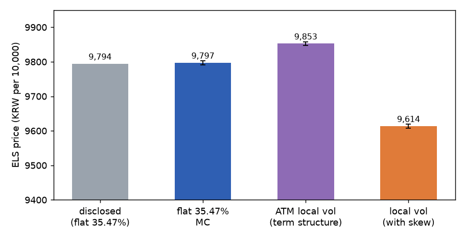
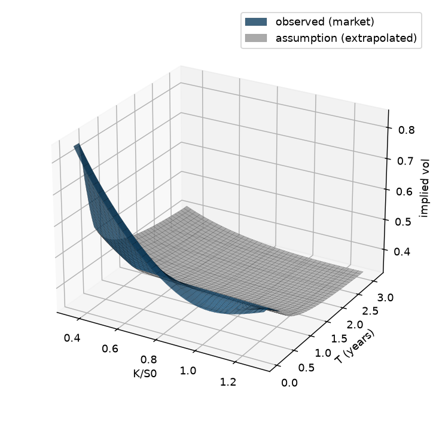

# kospi200-vol-surface

> **English summary.** Calibrates per-expiry SABR (β = 1) to KOSPI200 option settlement prices from KRX, builds an arbitrage-free total-variance surface, derives Dupire local vol from it, and prices an issued ELS (Mirae Asset Securities No. 38133, KOSPI200, 3Y, 40% knock-in) by Monte Carlo. With a flat 35.47% vol the engine reproduces the disclosed fair value (9,797 vs 9,794 won, 0.5 s.e.); with local vol the price is 9,614 won, a −239 won skew effect partly offset by +55 won from the term structure. Along the way, the calendar-arbitrage floor used for the surface turned out to make local vol exactly zero in a wedge of the surface; a small minimum forward variance with a smooth max fixes it without moving the fit to market data. Written as the solution to an assignment I designed as team lead of the U.FE.A financial engineering society. NumPy and SciPy only, tested with pytest.

KOSPI200 옵션 시장가격으로 만기별 SABR을 calibration해 차익거래 없는 변동성 곡면을 만들고, 그 곡면에서 Dupire local vol을 구해 실제 발행된 ELS를 Monte Carlo로 평가합니다.



## 과제 개요

U.FE.A 금융공학 학회 실습과제입니다. 팀장으로서 과제를 설계하고 해답을 작성했고, 이 저장소는 그 해답을 패키지로 정리한 것입니다. 과제 마감이 지난 뒤 공개합니다.

앞선 과제들은 변동성 하나를 주어진 값으로 썼습니다. 이 과제는 행사가와 만기마다 다른 변동성을 시장가격에서 직접 읽어 내고, 그 차이가 실제 상품 가격을 얼마나 바꾸는지까지 봅니다. 평가 대상은 미래에셋증권 제38133회 ELS입니다(기초자산 KOSPI200, 만기 3년, 6개월마다 조기상환 85/85/85/80/75%, 낙인 40%, 공시 공정가 9,794.24원, 평가 변동성 35.47%). 곡면의 범위(T = 0 ~ 3.1년, K/S0 = 0.35 ~ 1.30)는 이 상품의 만기와 낙인 수준을 덮도록 정했습니다.

학생이 직접 정해야 하는 값을 두고, 단계마다 assert 검증을 두어 판단이 틀리면 통과하지 못하게 했습니다.

## SABR 곡면


**forward.** 데이터에는 forward가 없습니다. 선물 종가, 무배당 carry, 옵션 가격에서 역산한 값 가운데 put-call parity로 구한 값을 골랐습니다. 옵션 IV를 맞추는 forward는 옵션 가격과 정합적이어야 하기 때문입니다. 12월물 parity forward(1056.2)는 선물 종가(1048.4)보다 약 74bp 높았습니다. 그래도 parity forward를 쓰면 같은 행사가의 콜과 풋이 4bp 안쪽의 같은 vol로 설명됩니다. 그래서 선물 종가와 옵션 정산가가 찍힌 시점이 다른 데서 생긴 차이로 봤습니다. 무배당 carry는 KOSPI200 배당을 무시하므로 쓰지 않았습니다.

**만기 선택.** 11개 만기 가운데 4개(2026-11, 2026-12, 2027-01, 2027-03)만 썼습니다. 10월물은 만기가 한 달도 남지 않아 스마일이 왜곡되고, 6월물 이후는 선물과 옵션 모두 체결이 거의 없어 이론정산가 위주입니다. 3월물도 선물은 29계약만 체결됐고 옵션 가격 32개 중 31개가 이론정산가입니다. 그래서 3월물은 쓰되 장기 외삽의 기준으로는 삼지 않았습니다.

**차익거래 제거.** SABR slice를 그대로 이어 붙이면 calendar 차익이 154건 생깁니다. 모두 2027-01에서 2027-03 사이, K/F < 0.56 영역입니다. 두 만기 모두 이 영역에 데이터가 없는 SABR 외삽 구간인데, 2027-01의 날개(ν = 0.94)가 거의 평평한 2027-03(ν = 0.07)보다 높아 total variance가 만기에 따라 줄어듭니다. 관측 slice의 total variance에 하한 w_i(m) ≥ w_{i-1}(m)을 두어 0건으로 만들었습니다. 이 하한은 시장 데이터가 있는 K/F ≥ 0.59에서는 값을 바꾸지 않습니다. (이 하한이 local vol 단계에서 문제를 일으켰습니다. 아래 참고.)

**장기 가정.** 마지막 관측 만기 이후는 가정으로 만듭니다. 3Y slice의 ρ, ν는 가장 유동적인 2026-12에서 가져오고 α는 3Y vol이 ELS 투자설명서의 평가 변동성 35.47%가 되도록 맞춥니다. 투자설명서는 이 값을 Volatility Surface에서 VIX 방법론(Jiang and Tian, 2005)으로 산출했다고 적고 있습니다. OTM 옵션 가격을 적분한 model-free implied variance이므로 ATM vol이 아니라 variance-swap vol에 맞췄습니다.

기준일 2026-09-14, S0 = 1050.83. `notebooks/01_surface.ipynb` 실행 출력입니다.

| 만기 | T | parity F | α | ρ | ν | 점 수 | RMSE |
|---|---:|---:|---:|---:|---:|---:|---:|
| 2026-11 | 0.162 | 1048.66 | 0.4221 | −0.0893 | 1.5683 | 79 | 176bp |
| 2026-12 | 0.238 | 1056.22 | 0.4246 | −0.0723 | 1.3000 | 162 | 65bp |
| 2027-01 | 0.334 | 1054.55 | 0.4330 | −0.0918 | 0.9406 | 16 | 19bp |
| 2027-03 | 0.488 | 1051.34 | 0.4422 | −0.5855 | 0.0654 | 32 | 36bp |

| 항목 | 값 |
|---|---:|
| 12월물 parity forward − 선물 종가 | 약 74bp |
| calendar 위반 (하한 전 → 후) | 154 → 0 |
| butterfly 위반 | 0 |
| 3Y variance-swap vol | 35.47% (공시 평가 변동성과 일치) |
| 3Y ATM vol | 33.28% |

2026-11은 RMSE가 176bp로 가장 큽니다. ATM 위쪽 행사가에서 점이 크게 흩어져 있고, 이 만기의 가격 79개 중 56개가 이론정산가입니다. 2027-03의 ρ = −0.59는 믿기 어렵습니다. ρ가 스마일에 주는 효과는 ν와 곱해져 나타나는데 이 만기는 ν ≈ 0.07이라 ρ가 거의 식별되지 않습니다. 장기 가정의 기준을 2026-12로 둔 이유입니다. 3Y variance-swap vol(35.47%)이 ATM vol(33.28%)보다 높은 것은 variance swap이 낮은 행사가의 높은 vol을 1/K² 가중으로 크게 반영하기 때문입니다. 공시 평가 변동성을 ATM vol로 잘못 읽으면 장기 구간의 vol이 그만큼 높아집니다.



## local vol과 ELS

### 검증을 통과한 곡면에서 local vol이 0이 되는 곳

위 곡면에 Dupire 식을 그대로 쓰면 T 0.35 ~ 0.45, K/F 0.35 ~ 0.55의 격자 63개(전체 5,952개 중)에서 local vol이 정확히 0입니다. calendar·butterfly 검증은 모두 통과한 곡면입니다.

원인은 위의 calendar 하한입니다. 하한 w_i ≥ w_{i-1}이 등호로 걸리는 날개에서는 K/F를 고정했을 때 total variance가 만기 방향으로 평평해집니다. 무차익 조건은 ∂w/∂T ≥ 0이라 위반은 아니지만, Dupire 식의 분자가 바로 ∂w/∂T이므로 그 영역의 local variance가 0이 됩니다. 차익은 없지만 확산이 없는 모형입니다.


**고친 방법.** 하한에 최소 선도분산을 더하고 hard max를 매끈한 max로 바꿨습니다.

w_i(m) = smooth_max( SABR_i(m), w_{i-1}(m) + v · (T_i − T_{i-1}) ),  smooth_max(a, b) = ε · ln(e^{a/ε} + e^{b/ε})

v는 시장 행사가에서 fit 변화가 0.05bp 안인 값 가운데 local vol 최솟값을 가장 크게 하는 0.0225(선도 vol 15%)를 골랐고, ε = 3e-4입니다. v를 0.035 이상으로 키우면 하한이 시장 데이터 구간까지 올라와 fit이 7bp 넘게 깨집니다. smooth max만 쓰고 v = 0으로 두면 쐐기가 그대로 남습니다.

| 항목 | 하한만 둔 곡면 | 보강한 곡면 |
|---|---:|---:|
| local vol 최솟값 | 0.000 | 0.098 |
| local vol < 1% 격자 | 63 | 0 |
| calendar · butterfly 위반 | 0 · 0 | 0 · 0 |
| 3Y variance-swap vol | 35.47% | 35.47% |
| 시장 행사가 fit 변화 | | 0.021bp |

fit 변화는 과제의 실제 시장 행사가 기준입니다. 저장소의 스크립트는 KRX 데이터 없이 K/F 0.59 ~ 1.30 균일 격자로 재므로 0.15bp가 나옵니다(데이터가 없는 짧은 만기의 행사가까지 포함하기 때문).

### ELS 가격

경로 2^17개(antithetic), seed 11, 평일 일별 794스텝. 최초기준가격은 투자설명서대로 2026-10-02 종가를 시뮬레이션해서 정합니다. 낙인은 그다음 날부터 일별 종가로 봅니다.

| 모형 | 가격 | 공시 대비 |
|---|---:|---:|
| 공시 공정가 (flat 35.47%) | 9,794.24 | |
| MC, flat 35.47% | 9,797.05 ± 5.57 | +2.81 (0.5se) |
| MC, flat 35.47%, 최초기준가격 = 기준일 종가 | 9,752.45 ± 5.78 | −41.79 |
| MC, ATM local vol 기간구조만 | 9,852.52 ± 5.50 | +58.28 |
| MC, local vol | 9,613.54 ± 6.53 | −180.70 (−1.84%) |

flat MC가 공시가를 0.5se 안에서 재현하므로 상품 조건과 엔진은 맞다고 봤습니다. 최초기준가격을 기준일 종가로 두면 7se만큼 낮아져 이 검증에서 걸립니다. 공정가 기준일(09-14)이 최초기준가격 평가일(10-02)보다 18일 앞이기 때문입니다.

local vol 가격은 flat MC보다 183.5원 낮습니다. 기간구조만 반영하면 +55.5원, 여기에 스큐를 더하면 −239.0원입니다.

- **기간구조(+55.5원).** 이 곡면은 만기가 길수록 implied vol이 내려갑니다. 만기까지의 평균이 내려가려면 그 순간의 vol은 평균보다 더 낮아야 해서, ATM local vol은 T = 1에서 0.303으로 implied 0.379보다 훨씬 낮습니다. 변동성이 낮으면 낙인에 덜 닿으므로 가격이 오릅니다.
- **스큐(−239.0원).** 하락할수록 local vol이 커집니다(K/F 0.5에서 implied보다 2~3%p 높음). 하락 경로가 더 깊게 내려가 낙인에 닿기 쉽습니다. 이 ELS는 투자자가 하방 풋을 판 구조라 하방 변동성이 높을수록 가치가 떨어집니다.

| 상환 | flat 확률 | local vol 확률 |
|---|---:|---:|
| 1차 조기상환 | 70.5% | 65.5% |
| 2~5차 조기상환 | 16.3% | 18.6% |
| 만기상환 | 13.2% | 15.9% |
| 만기 손실 (낙인 & 70% 미만) | 8.5% | 11.0% |
| 낙인 터치 | 17.5% | 18.8% |

local vol 경로로 vanilla 옵션을 다시 가격 매기면 곡면 implied vol과 최대 18bp(3년 ATM) 안에서 맞습니다. 경로가 곡면을 재현한다는 확인입니다.

공시가는 flat 35.47%의 이론가입니다. 액면 10,000원 기준 발행사의 마진 여지는 flat으로 약 206원, 스큐를 반영하면 약 386원입니다. 다만 이 차이를 이익으로 곧장 읽을 수는 없습니다. 3년 만기의 깊은 외가격 풋은 상장 옵션으로 살 수 없어 이 스큐 위험은 헤지하기 어렵고, 스큐 효과를 만드는 3년·낙인 영역의 vol은 시장가격이 아니라 장기 가정에서 나옵니다.

## 구현

```
kospi200-vol-surface/
├── src/volsurface/
│   ├── config.py       기준일, 현물가, 금리 호가, ELS 입력값, 하한 크기
│   ├── curve.py        CD91 + 국고채 par yield 부트스트랩, 만기일
│   ├── forward.py      put-call parity forward
│   ├── sabr.py         Black 가격·IV, Hagan (2.17) β = 1
│   ├── calibrate.py    만기별 calibration
│   ├── surface.py      total variance 보간, calendar 하한(최소 선도분산·smooth max), 장기 가정, variance-swap vol
│   ├── arbitrage.py    calendar, butterfly 점검
│   ├── localvol.py     Dupire local vol (forward moneyness 고정 미분), 진단 격자
│   └── els.py          ELS 조건, 시간 격자, 가격 이동, 경로별 현재가치, local vol 표, MC 엔진
├── scripts/preprocess.py     KRX 원자료 → data/*.csv
├── scripts/run_els.py        local vol 단계 전체: 쐐기 진단, 하한 크기 표, ELS 가격·분해·상환 확률, 그림
├── notebooks/01_surface.ipynb
├── figures/
└── tests/
```

- 모든 계산은 NumPy 배열 연산입니다. SABR, implied vol, local vol을 대신 계산하는 라이브러리는 쓰지 않았습니다. MC는 시간 스텝만 반복하고 경로는 배열로 처리합니다.
- Dupire의 시간 미분은 K가 아니라 forward 기준 moneyness y = ln(K/F)를 고정하고 취합니다. 금리와 배당이 있으면 F가 T에 따라 움직이기 때문입니다.
- local vol은 시뮬레이션 시각마다 K/S0 0.35 ~ 1.30 격자에 미리 계산해 두고, 경로마다 현재 S에서 선형 보간합니다.
- KRX 원자료와 가공 CSV는 약관 때문에 저장소에 넣지 않습니다. 테스트와 `scripts/run_els.py`는 calibration 결과인 SABR 파라미터(`tests/fixtures/sabr_params.csv`)로 곡면을 만들어 돌립니다. 투자설명서도 넣지 않았습니다(전자공시에서 볼 수 있습니다).

## 한계

- 3년 구간과 낙인 40% 영역은 시장가격이 아니라 가정(3Y slice의 기준, 장기 ρ·ν, 배당 가정)으로 만든 부분이고, ELS 가격의 스큐 효과 대부분이 여기서 나옵니다.
- calendar 하한은 데이터가 없는 날개를 고치는 최소한의 처리이고, 날개의 모양 자체는 여전히 SABR 외삽입니다.
- 휴장일은 반영하지 않았고(평일 = 영업일), 지급일은 평가일 + 3영업일로 계산했습니다.
- local vol 모형은 오늘의 곡면은 정확히 맞추지만, 스팟이 움직일 때 스마일이 어떻게 바뀌는지를 모형이 정해 버리고 그 방향이 실제 시장과 반대라는 비판이 있습니다(Hagan et al., 2002). 같은 곡면을 맞추는 확률변동성 모형과 가격·그릭스를 비교하는 것이 다음 단계입니다.

## 이슈 기록

**선물 종가를 forward로 쓰면 콜·풋 vol이 어긋남.** 12월물 선물 종가를 forward로 쓰면 같은 행사가의 콜과 풋 IV 차이가 중앙값 385bp로 벌어집니다. parity forward에서는 4bp입니다. 3월물도 396bp와 6bp로 같은 양상입니다.

**SABR 외삽끼리 교차해 calendar 차익 발생.** "SABR 곡면"의 "차익거래 제거"에 적었습니다. 위반 위치를 만기 구간과 K/F로 묶어 출력하면 원인이 데이터 없는 날개라는 것이 바로 보입니다.

**검증을 통과한 곡면에서 local vol이 0.** "local vol과 ELS" 첫 절에 적었습니다. 곡면의 검증(calendar 위반 0건)이 "∂w/∂T < 0인 점이 없다"만 보고 "= 0인 영역"은 보지 않았기 때문에 생긴 문제입니다.

## 실행 방법

Python 3.10 이상.

```bash
pip install -e ".[dev]"
pytest
python scripts/run_els.py          # local vol·ELS 수치와 그림 (약 30초, 그림은 matplotlib 필요)
```

곡면 노트북을 다시 돌리려면 KRX 정보데이터시스템에서 2026-09-14 KOSPI200 옵션·선물 일별 시세(주간)를 받아 `data/raw/kospi200_options.csv`, `data/raw/kospi200_futures.csv`로 저장한 뒤:

```bash
pip install -e ".[notebook]"
python scripts/preprocess.py
cd notebooks
python -m nbconvert --to notebook --execute --inplace 01_surface.ipynb
```

## 개발 방식

과제 설계, 데이터 가공, 해답 노트북은 직접 작성했습니다. 포트폴리오 정리에는 Claude Code를 썼습니다. 해답 노트북을 `src/volsurface/` 모듈로 나누고, 테스트, CI, 이 README를 추가했습니다.

검증은 이렇게 했습니다.

- 패키지로 옮긴 코드를 원본 데이터로 돌려 parity forward, SABR 파라미터, RMSE, 위반 건수, 3Y vol이 해답 노트북 출력과 모두 같은지 확인했습니다.
- local vol·ELS 모듈은 같은 seed로 돌려 해답 노트북의 숫자(flat 9,797.05 ± 5.57, local vol 9,613.54 ± 6.53, 쐐기 격자 63개, 보강 후 최솟값 0.098)가 그대로 나오는지 확인했습니다.
- 테스트가 실제로 오류를 잡는지 보려고 구현을 일부러 망가뜨려 돌려 봤습니다. 가격 이동에서 −σ²/2 누락, 낙인 기준을 최초기준가격 대신 기준일 종가로, Dupire 시간 미분을 K 고정으로, 하한에서 ΔT 누락, 만기 지급 할인 누락 다섯 경우 모두 테스트가 실패했습니다.

| 테스트 | 확인 내용 |
|---|---|
| `test_sabr.py` | K = F에서 nan 없음, Hagan (2.18) ATM 값과 (2.17) 날개 참값 일치 |
| `test_curve.py` | 부트스트랩 커브가 입력 호가 5개(CD91, 국고채 1·2·3·5년)를 재현 |
| `test_surface.py` | 곡면의 calendar·butterfly 위반 0건, 하한을 끄면 154건, 데이터 구간에서 fit 유지, 3Y variance-swap vol = 35.47% |
| `test_localvol.py` | flat 곡면에서 local vol = σ, moneyness 고정 미분의 해석해 일치, 하한만 둔 곡면의 쐐기 63개, 보강한 곡면의 최솟값 > 8%·무차익·fit 유지, smooth max의 폭 |
| `test_els.py` | 손으로 만든 경로의 상환금액, 가격 이동의 martingale, 시간 격자, flat 가격의 공시가 재현, 기준일 종가를 쓰면 낮아짐, local vol 가격 범위 (경로 2^14개) |

## 참고 문헌

- Hagan, P. S., Kumar, D., Lesniewski, A. S., Woodward, D. E. (2002). Managing Smile Risk. *Wilmott Magazine*.
- Dupire, B. (1994). Pricing with a Smile. *Risk*.
- Gatheral, J. (2006). *The Volatility Surface*. Wiley.
- Jiang, G. J., Tian, Y. S. (2005). The Model-Free Implied Volatility and Its Information Content. *Review of Financial Studies*.
- 미래에셋증권 제38133회 ELS 투자설명서 (전자공시)
