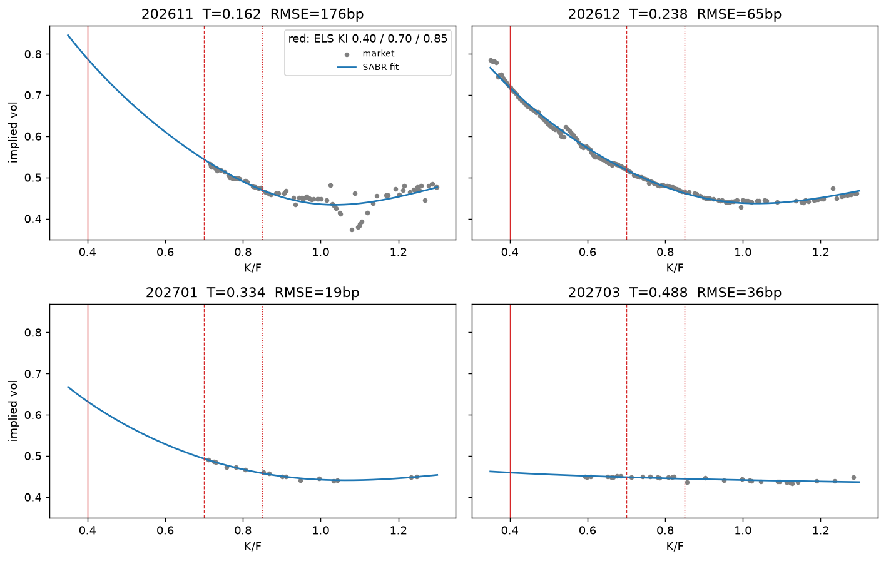
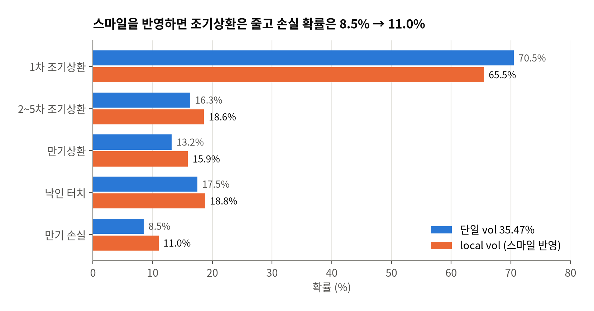
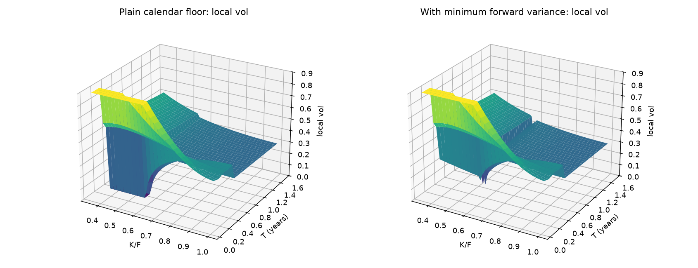

# kospi200-vol-surface

> **English summary.** I re-priced an issued ELS (Mirae Asset Securities No. 38133: KOSPI200, 3Y, step-down autocall, 40% knock-in) using the volatility smile read from KRX KOSPI200 option prices. With the same flat 35.47% vol as the disclosure, my Monte Carlo reproduces the disclosed fair value (9,797 vs 9,794 won per 10,000). With the full smile (SABR surface → Dupire local vol) the price falls to 9,614 won: put skew costs 239 won because crash paths hit the knock-in more often, and a downward-sloping term structure gives back 55 won. Under the smile the probability of a loss at maturity rises from 8.5% to 11.0%. The flat price leaves the issuer about 206 won of margin; with skew it is about 386 won, but that extra skew risk sits in 3-year deep out-of-the-money puts that cannot be hedged with listed options. Written as the solution to an assignment I designed as team lead of the U.FE.A financial engineering society.

KOSPI200 옵션 시장의 변동성 스마일로 실제 발행된 ELS를 다시 평가했습니다. 공시가와 같은 단일 변동성으로 공시가를 재현한 뒤, 스마일을 반영하면 가격이 얼마나, 왜 달라지는지 분해했습니다. U.FE.A 금융공학학회 팀장으로 설계한 실습과제의 해답을 정리한 저장소입니다.

## 평가한 상품

| 항목 | 내용 |
|---|---|
| 상품 | 미래에셋증권 제38133회 ELS |
| 기초자산 | KOSPI200 |
| 만기 | 3년, 6개월마다 조기상환 평가 |
| 조기상환 조건 | 최초기준가격의 85 / 85 / 85 / 80 / 75% 이상 |
| 낙인 | 40% (일별 종가로 관찰) |
| 만기 상환 | 만기에 70% 이상이거나 낙인이 없었으면 12,760원, 아니면 지수 하락률만큼 손실 |
| 공시 공정가 | 9,794.24원 (액면 10,000원, 평가 변동성 35.47%) |

투자자는 KOSPI200 하방 풋을 판 것과 같은 위험을 집니다. 지수가 40% 아래로 한 번이라도 빠지면 낙인에 닿고, 만기에 70%까지 회복하지 못하면 원금 손실이 납니다. 그래서 하방 변동성을 얼마로 보느냐가 가격을 크게 바꿉니다. 공시 공정가는 모든 행사가와 만기에 같은 변동성 하나(35.47%)를 쓴 값입니다.

## 한 일

1. **시장 스마일 읽기.** 2026-09-14 KRX KOSPI200 옵션 가격에서 만기별로 SABR 모형을 맞춰 행사가별 변동성을 읽었습니다.
2. **3년까지 이어지는 곡면 만들기.** 관측된 만기 4개를 이어 붙이고 3년까지 늘렸습니다. 달력·나비 차익거래가 없도록 정리했고, 3년 구간은 공시 평가 변동성 35.47%에 맞췄습니다.
3. **ELS 다시 평가하기.** 곡면에서 Dupire local vol을 구해 ELS를 Monte Carlo(경로 131,072개, 일별)로 평가했습니다. 단일 vol 가격으로 엔진을 먼저 검증하고, 기간구조와 스큐의 효과를 따로 떼어 봤습니다.



빨간 세로선은 ELS의 낙인(40%), 만기 상환 기준(70%), 1~3차 조기상환 기준(85%) 위치입니다. 낙인이 걸린 40% 부근은 시장 데이터가 거의 없어, 이 영역의 변동성은 모형으로 이어 붙인 값입니다.

## 결과

| 모형 | 가격 (원) | 공시 대비 |
|---|---:|---:|
| 공시 공정가 (단일 vol 35.47%) | 9,794.24 | |
| 내 엔진, 단일 vol 35.47% | 9,797.05 ± 5.57 | +2.81 (0.5 표준오차) |
| 기간구조만 반영 | 9,852.52 ± 5.50 | +58.28 |
| 스마일 전체 반영 (local vol) | 9,613.54 ± 6.53 | −180.70 (−1.84%) |



**스큐 −239원.** 지수가 내려갈수록 local vol이 커집니다(K/F 0.5에서 implied보다 2~3%p 높음). 하락하는 경로가 더 깊이 내려가 낙인에 닿기 쉬워지고, 만기 손실 확률이 8.5%에서 11.0%로 오릅니다.

**기간구조 +55원.** 이 곡면은 만기가 길수록 변동성이 낮아집니다. 그래서 ATM local vol은 1년 시점에 30.3%로 implied 37.9%보다 낮고, 변동성이 낮은 만큼 낙인에 덜 닿습니다.

**발행사 입장.** 공시가 9,794원은 단일 vol 이론가입니다. 액면 10,000원 기준 발행사의 마진 여지는 단일 vol로 약 206원, 스큐를 반영하면 약 386원입니다. 이 차이를 이익으로 곧장 읽을 수는 없습니다. 스큐 효과를 만드는 3년·낙인 영역의 변동성은 시장가격이 아니라 장기 가정에서 나오고, 3년 만기 깊은 외가격 풋은 상장 옵션으로 살 수 없어 이 위험은 헤지하기 어렵습니다.

## 판단 포인트

**forward를 어디서 읽을지.** 선물 종가 대신 옵션 가격의 put-call parity로 forward를 정했습니다. 12월물 parity forward(1056.2)는 선물 종가(1048.4)보다 약 74bp 높았습니다. 선물 종가를 쓰면 같은 행사가의 콜과 풋 변동성이 중앙값 385bp 벌어지고, parity forward에서는 4bp입니다. 선물 종가와 옵션 정산가가 찍힌 시점이 달라서 생긴 차이로 봤습니다.

**어떤 만기를 믿을지.** 11개 만기 가운데 4개만 썼습니다. 10월물은 만기가 한 달도 남지 않아 스마일이 왜곡되고, 6월물 이후는 체결이 거의 없어 이론정산가 위주입니다. 3월물도 선물 29계약, 옵션 가격 32개 중 31개가 이론정산가라 장기 외삽의 기준은 12월물로 두었습니다.

**공시 변동성 35.47%를 어떻게 읽을지.** 투자설명서는 이 값을 VIX 방법론으로 산출했다고 적고 있습니다. OTM 옵션 전체를 적분한 값이라 ATM vol이 아니라 variance-swap vol에 맞췄습니다. 이렇게 맞추면 3년 ATM vol은 33.28%입니다. ATM vol로 잘못 읽으면 장기 구간 변동성을 2%p가량 높게 잡게 됩니다.

**최초기준가격.** 투자설명서대로 2026-10-02 종가를 시뮬레이션해서 정했습니다. 공정가 기준일(09-14) 종가를 쓰면 가격이 41.8원(7 표준오차) 낮아져 공시가 재현에 실패합니다.

## 모델 점검: 검증을 통과한 곡면에서 local vol이 0

차익거래 점검을 모두 통과한 곡면인데도 Dupire 식을 그대로 쓰면 날개 쪽 격자 63개에서 local vol이 정확히 0이 나왔습니다. 달력 차익을 막으려고 둔 하한 때문에 그 영역의 분산이 만기 방향으로 평평해졌고, Dupire 식의 분자가 바로 그 기울기라서 생긴 문제입니다. 차익은 없지만 그 구간에서 가격이 움직이지 않는 모형이 됩니다. 하한에 작은 최소 선도분산(선도 vol 15%)을 더해 고쳤고, 시장 행사가에서 fit 변화는 0.021bp였습니다.



## 한계와 다음 단계

- 3년 구간과 낙인 40% 영역은 시장가격이 아니라 가정(3년 기준값, 장기 ρ·ν, 배당)으로 만든 부분이고, 스큐 효과 대부분이 여기서 나옵니다.
- 휴장일은 반영하지 않았습니다(평일 = 영업일).
- local vol 모형은 스팟이 움직일 때 스마일이 어떻게 바뀌는지를 모형이 정해 버리고, 그 방향이 실제 시장과 반대라는 비판이 있습니다(Hagan et al., 2002). 같은 곡면을 맞추는 확률변동성 모형과 가격·그릭스를 비교하는 것이 다음 단계입니다.

<details>
<summary><b>구현 세부 (SABR 파라미터, 코드 구조, 실행 방법, 검증)</b></summary>

### SABR 파라미터

기준일 2026-09-14, S0 = 1050.83. Hagan et al. (2002) 근사식, β = 1. `notebooks/01_surface.ipynb` 실행 출력입니다.

| 만기 | T | parity F | α | ρ | ν | 점 수 | RMSE |
|---|---:|---:|---:|---:|---:|---:|---:|
| 2026-11 | 0.162 | 1048.66 | 0.4221 | −0.0893 | 1.5683 | 79 | 176bp |
| 2026-12 | 0.238 | 1056.22 | 0.4246 | −0.0723 | 1.3000 | 162 | 65bp |
| 2027-01 | 0.334 | 1054.55 | 0.4330 | −0.0918 | 0.9406 | 16 | 19bp |
| 2027-03 | 0.488 | 1051.34 | 0.4422 | −0.5855 | 0.0654 | 32 | 36bp |

| 항목 | 값 |
|---|---:|
| calendar 위반 (하한 전 → 후) | 154 → 0 |
| butterfly 위반 | 0 |
| 3Y variance-swap vol | 35.47% (공시 평가 변동성과 일치) |
| 3Y ATM vol | 33.28% |

2026-11은 RMSE가 176bp로 가장 큽니다. 가격 79개 중 56개가 이론정산가입니다. 2027-03의 ρ = −0.59는 ν ≈ 0.07이라 거의 식별되지 않습니다. 장기 가정의 기준을 2026-12로 둔 이유입니다.

**차익거래 제거.** SABR slice를 그대로 이어 붙이면 calendar 차익이 154건 생깁니다. 모두 2027-01에서 2027-03 사이, K/F < 0.56의 데이터 없는 외삽 영역입니다. 관측 slice의 total variance에 하한 w_i(m) ≥ w_{i-1}(m)을 두어 0건으로 만들었습니다. 시장 데이터가 있는 K/F ≥ 0.59에서는 값이 바뀌지 않습니다.

**local vol 쐐기 수정.** 하한에 최소 선도분산을 더하고 hard max를 매끈한 max로 바꿨습니다.

w_i(m) = smooth_max( SABR_i(m), w_{i-1}(m) + v · (T_i − T_{i-1}) ),  smooth_max(a, b) = ε · ln(e^{a/ε} + e^{b/ε})

v = 0.0225(선도 vol 15%), ε = 3e-4. v를 0.035 이상으로 키우면 fit이 7bp 넘게 깨지고, v = 0이면 쐐기가 남습니다.

| 항목 | 하한만 둔 곡면 | 보강한 곡면 |
|---|---:|---:|
| local vol 최솟값 | 0.000 | 0.098 |
| local vol < 1% 격자 | 63 | 0 |
| calendar · butterfly 위반 | 0 · 0 | 0 · 0 |
| 3Y variance-swap vol | 35.47% | 35.47% |
| 시장 행사가 fit 변화 | | 0.021bp |

저장소의 스크립트는 KRX 데이터 없이 K/F 0.59 ~ 1.30 균일 격자로 재므로 fit 변화가 0.15bp로 나옵니다.

**ELS 엔진.** 경로 2^17개(antithetic), seed 11, 평일 일별 794스텝. local vol 경로로 vanilla 옵션을 다시 가격 매기면 곡면 implied vol과 최대 18bp(3년 ATM) 안에서 맞습니다.

| 상환 | 단일 vol 확률 | local vol 확률 |
|---|---:|---:|
| 1차 조기상환 | 70.5% | 65.5% |
| 2~5차 조기상환 | 16.3% | 18.6% |
| 만기상환 | 13.2% | 15.9% |
| 만기 손실 (낙인 & 70% 미만) | 8.5% | 11.0% |
| 낙인 터치 | 17.5% | 18.8% |

### 코드 구조

```
kospi200-vol-surface/
├── src/volsurface/
│   ├── config.py       기준일, 현물가, 금리 호가, ELS 입력값, 하한 크기
│   ├── curve.py        CD91 + 국고채 par yield 부트스트랩, 만기일
│   ├── forward.py      put-call parity forward
│   ├── sabr.py         Black 가격·IV, Hagan (2.17) β = 1
│   ├── calibrate.py    만기별 calibration
│   ├── surface.py      total variance 보간, calendar 하한(최소 선도분산·smooth max), 장기 가정, variance-swap vol
│   ├── arbitrage.py    calendar, butterfly 점검
│   ├── localvol.py     Dupire local vol (forward moneyness 고정 미분), 진단 격자
│   └── els.py          ELS 조건, 시간 격자, 가격 이동, 경로별 현재가치, local vol 표, MC 엔진
├── scripts/preprocess.py     KRX 원자료 → data/*.csv
├── scripts/run_els.py        local vol 단계 전체: 쐐기 진단, 하한 크기 표, ELS 가격·분해·상환 확률, 그림
├── notebooks/01_surface.ipynb
├── figures/
└── tests/
```

- 모든 계산은 NumPy 배열 연산입니다. SABR, implied vol, local vol을 대신 계산하는 라이브러리는 쓰지 않았습니다.
- Dupire의 시간 미분은 K가 아니라 forward 기준 moneyness y = ln(K/F)를 고정하고 취합니다. 금리와 배당이 있으면 F가 T에 따라 움직이기 때문입니다.
- KRX 원자료와 가공 CSV는 약관 때문에 저장소에 넣지 않습니다. 테스트와 `scripts/run_els.py`는 calibration 결과인 SABR 파라미터(`tests/fixtures/sabr_params.csv`)로 곡면을 만들어 돌립니다. 투자설명서도 넣지 않았습니다(전자공시에서 볼 수 있습니다).

### 실행 방법

Python 3.10 이상.

```bash
pip install -e ".[dev]"
pytest
python scripts/run_els.py          # local vol·ELS 수치와 그림 (약 30초, 그림은 matplotlib 필요)
```

곡면 노트북을 다시 돌리려면 KRX 정보데이터시스템에서 2026-09-14 KOSPI200 옵션·선물 일별 시세(주간)를 받아 `data/raw/kospi200_options.csv`, `data/raw/kospi200_futures.csv`로 저장한 뒤:

```bash
pip install -e ".[notebook]"
python scripts/preprocess.py
cd notebooks
python -m nbconvert --to notebook --execute --inplace 01_surface.ipynb
```

### 개발 방식과 검증

과제 설계, 데이터 가공, 해답 노트북은 직접 작성했습니다. 포트폴리오 정리에는 Claude Code를 썼습니다. 해답 노트북을 `src/volsurface/` 모듈로 나누고, 테스트, CI, README를 추가했습니다.

- 패키지로 옮긴 코드를 원본 데이터로 돌려 parity forward, SABR 파라미터, RMSE, 위반 건수, 3Y vol이 해답 노트북 출력과 모두 같은지 확인했습니다.
- local vol·ELS 모듈은 같은 seed로 돌려 해답 노트북의 숫자(단일 vol 9,797.05 ± 5.57, local vol 9,613.54 ± 6.53, 쐐기 격자 63개, 보강 후 최솟값 0.098)가 그대로 나오는지 확인했습니다.
- 구현을 일부러 망가뜨려 테스트가 잡는지 봤습니다. 가격 이동에서 −σ²/2 누락, 낙인 기준을 기준일 종가로 바꿈, Dupire 시간 미분을 K 고정으로 바꿈, 하한에서 ΔT 누락, 만기 지급 할인 누락 다섯 경우 모두 테스트가 실패했습니다.

| 테스트 | 확인 내용 |
|---|---|
| `test_sabr.py` | K = F에서 nan 없음, Hagan (2.18) ATM 값과 (2.17) 날개 참값 일치 |
| `test_curve.py` | 부트스트랩 커브가 입력 호가 5개(CD91, 국고채 1·2·3·5년)를 재현 |
| `test_surface.py` | 곡면의 calendar·butterfly 위반 0건, 하한을 끄면 154건, 데이터 구간에서 fit 유지, 3Y variance-swap vol = 35.47% |
| `test_localvol.py` | flat 곡면에서 local vol = σ, moneyness 고정 미분의 해석해 일치, 하한만 둔 곡면의 쐐기 63개, 보강한 곡면의 최솟값 > 8%·무차익·fit 유지 |
| `test_els.py` | 손으로 만든 경로의 상환금액, 가격 이동의 martingale, flat 가격의 공시가 재현, 기준일 종가를 쓰면 낮아짐, local vol 가격 범위 |

</details>

## 참고 문헌

- Hagan, P. S., Kumar, D., Lesniewski, A. S., Woodward, D. E. (2002). Managing Smile Risk. *Wilmott Magazine*.
- Dupire, B. (1994). Pricing with a Smile. *Risk*.
- Gatheral, J. (2006). *The Volatility Surface*. Wiley.
- Jiang, G. J., Tian, Y. S. (2005). The Model-Free Implied Volatility and Its Information Content. *Review of Financial Studies*.
- 미래에셋증권 제38133회 ELS 투자설명서 (전자공시)
